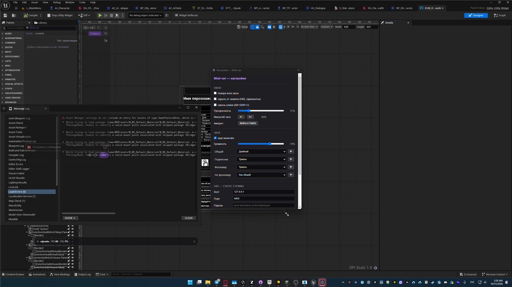

# 💬 ObsHiddenChat

<div align="center">

**Полупрозрачный Twitch-чат поверх игр и рабочего стола, полностью невидимый для OBS и захвата экрана.**  
*Semi-transparent overlay Twitch chat over games & desktop, completely excluded from OBS and screen capture.*

<br>

---

### 🌐 Выберите язык / Select Language:

[](#-русский)
&nbsp;&nbsp;&nbsp;&nbsp;
[](#-english)

---

</div>

<details open>
<summary><h2 id="-русский">🇷🇺 Русский</h2></summary>

Полупрозрачное окно с чатом Twitch поверх всего на основном мониторе: видно **только стримеру** — OBS (даже «Захват экрана» целого монитора), Discord-стрим и скриншоты его не видят.

---

### ✨ Ключевые возможности

1. **Невидимость для OBS и стрима**:
   - Windows 10 (2004+) / 11 маркирует окно системным флагом `WDA_EXCLUDEFROMCAPTURE`. Окно физически рисуется на мониторе, но аппаратно исключается из всех API захвата экрана (OBS, Discord, ShadowPlay, скриншоты).
   - В OBS не нужно настраивать никаких исключений — захват просто не видит это окно.
2. **👥 Полный список онлайн-зрителей Twitch (все подключенные пользователи)**:
   - Стандартный веб-виджет Твича или всплывающее окно чата часто отображает не всех зрителей (только активных чаттеров или неполную выборку).
   - **ObsHiddenChat** подключается к Twitch IRC с флагом `CAP REQ :twitch.tv/membership` и автоматически получает полный список пользователей через `353 NAMES`, а также события `JOIN` и `PART` в реальном времени.
   - Показывает **всех** подключенных к комнате зрителей (включая не пишущих в чат / lurkers, модераторов, VIP и подписчиков).
   - Быстрый поиск зрителя по нику в выпадающей панели `👥`.
3. **🔔 Звуковые оповещения о входе конкретных пользователей + свои звуки**:
   - Возможность отслеживать конкретных пользователей (друзей, VIP, модераторов, постоянных зрителей).
   - Для каждого пользователя можно выбрать любой из 6 встроенных синтезированных звуков или указать **свой аудиофайл** (`.mp3`, `.wav`, `.ogg`, `.m4a`, `.aac`, `.flac`).
   - Удобная кнопка **«Обзор...»** с нативным диалогом выбора файла Windows.
   - Кнопка **▶** для мгновенного прослушивания звука прямо в настройках.
   - Всплывающее уведомление (toast) в окне: `👋 [ник] зашёл на стрим!`.
   - Настраиваемый кулдаун (по умолчанию 60 сек), чтобы избежать спама звуками при кратковременных обрывах связи.
   - Опциональный переключатель: «Оповещать о приходе ЛЮБОГО зрителя».
4. **🎵 Звуковые уведомления о сообщениях в чате**:
   - Автоматическая классификация сообщений по Twitch-бейджам: **подписчик / фолловер / зритель**.
   - Настраиваемый звук для каждой категории (6 встроенных вариантов) и общая громкость.
5. **⌨️ Режим сквозных кликов (Click-Through)**:
   - Включается по `Alt+Shift+C`. Клики мыши проходят прямо сквозь чат в игру, окно не перехватывает фокус.
6. **📊 Панель статуса стрима OBS**:
   - Выносная компактная строка поверх всего (кнопка `⧉`): таймкод LIVE / REC, битрейт, потери кадров, FPS, нагрузка CPU через протокол OBS WebSocket v5.

<br>

<div align="center">
  
</div>

---

### 🚀 Быстрый старт

#### Требования
- **ОС:** Windows 10 (версия 2004 или новее) или Windows 11
- **Среда:** [Node.js](https://nodejs.org/) (версия 18+)

#### Установка и запуск

```bash
# Клонирование репозитория
git clone https://github.com/Mmitekk/ObsHiddenChat.git
cd ObsHiddenChat

# Установка зависимостей
npm install

# Запуск приложения
npm start
```

> **Совет:** Для удобного запуска без терминала воспользуйтесь скриптом `tools/make-shortcut.ps1` — он создаст или обновит ярлык **Stream Chat (hidden)** на рабочем столе.

---

### 🎮 Горячие клавиши (глобальные)

| Сочетание | Действие |
|---|---|
| **Alt+Shift+H** | Скрыть / показать окно виджета |
| **Alt+Shift+C** | Включить / выключить режим «сквозь клики» |
| **Alt+Shift+↑** | Увеличить прозрачность окна (+10%) |
| **Alt+Shift+↓** | Уменьшить прозрачность окна (-10%) |

---

### ⚙️ Настройки и интерфейс

- **Канал Twitch:** Введите ник канала (или ссылку) в поле и нажмите «Открыть».
- **Кнопка 👥:** Открывает панель зрителей онлайн со счетчиком, поиском и кнопкой привязки звука `+ Оповещение`.
- **Кнопка ⚙:** Открывает панель настроек (окно настроек также скрыто от захвата OBS).
- **Войти в Twitch:** Вход в свой аккаунт прямо внутри виджета. Сессия сохраняется в профиле программы (`%APPDATA%\obs-hidden-chat`), что позволяет писать в чат от своего имени.
- **Подключение к OBS WebSocket:** Если в OBS включен WebSocket (Инструменты → Настройки сервера WebSocket), виджет автоматически считает порт и пароль из конфига OBS.

</details>

---

<details>
<summary><h2 id="-english">🇬🇧 English</h2></summary>

A semi-transparent Twitch chat overlay displayed on top of everything on your main monitor: visible **only to the streamer** — OBS (even full monitor Display Capture), Discord screen sharing, and screenshots cannot capture it.

---

### ✨ Key Features

1. **Invisible to OBS & Screen Capture**:
   - Utilizes Windows 10 (2004+) / 11 `WDA_EXCLUDEFROMCAPTURE` window flag. The window renders physically on your monitor, but is completely excluded by hardware from screen capture APIs.
   - Zero configuration needed in OBS — OBS does not know this window exists.
2. **👥 Full Twitch Online Viewers Tracking (All Connected Users)**:
   - Standard Twitch web chat or popups often omit viewers who are just watching without typing.
   - **ObsHiddenChat** connects to Twitch IRC with `CAP REQ :twitch.tv/membership` and automatically retrieves all connected users via `353 NAMES` as well as real-time `JOIN` and `PART` events.
   - Displays **all** users present in the chat room (including lurkers, moderators, VIPs, and subscribers).
   - Fast filter & search by username inside the `👥` drawer.
3. **🔔 Arrival Sound Notifications for Specific Users + Custom Audio**:
   - Track arrival of specific users (friends, VIPs, moderators, frequent viewers).
   - Assign either built-in synthesized tones (Ping, Double Blip, Drop, Bell, Pop, Triad) or **your own custom audio file** (`.mp3`, `.wav`, `.ogg`, `.m4a`, `.aac`, `.flac`).
   - Convenient **"Browse..."** button with Windows native file picker.
   - Instant preview button **▶** in settings.
   - On-screen toast banner: `👋 [username] joined the stream!`.
   - Adjustable cooldown (default 60s) to prevent sound spam during reconnection blips.
   - Optional toggle: "Alert on ANY viewer arrival".
4. **🎵 Chat Message Sound Notifications**:
   - Classifies messages by Twitch badges: **Subscriber / Follower / Non-follower**.
   - Distinct sound presets for each category with master volume control.
5. **⌨️ Click-Through Mode**:
   - Toggle with `Alt+Shift+C`. Mouse clicks pass directly through the chat into your game without stealing focus.
6. **📊 OBS Stream Status Overlay**:
   - Detachable floating status bar (`obspanel.html` via `⧉` button): real-time LIVE / REC timecode, bitrate, dropped frame rate, FPS, and CPU usage via OBS WebSocket v5 protocol.

<br>

<div align="center">
  
</div>

---

### 🚀 Getting Started

#### Prerequisites
- **OS:** Windows 10 (version 2004 or newer) or Windows 11
- **Runtime:** [Node.js](https://nodejs.org/) (v18+)

#### Installation & Run

```bash
# Clone the repository
git clone https://github.com/Mmitekk/ObsHiddenChat.git
cd ObsHiddenChat

# Install dependencies
npm install

# Start the application
npm start
```

> **Tip:** You can create or update a desktop shortcut by running `tools/make-shortcut.ps1` in PowerShell.

---

### 🎮 Global Hotkeys

| Shortcut | Description |
|---|---|
| **Alt+Shift+H** | Hide / show widget window |
| **Alt+Shift+C** | Toggle click-through mode |
| **Alt+Shift+↑** | Increase window opacity (+10%) |
| **Alt+Shift+↓** | Decrease window opacity (-10%) |

---

### ⚙️ Settings & Configuration

- **Twitch Channel:** Enter the channel username or URL and click "Open".
- **👥 Button:** Opens the live viewers drawer with viewer counter, search bar, and quick `+ Alert` shortcut.
- **⚙ Button:** Opens the settings window (also excluded from OBS capture).
- **Twitch Login:** Log into your Twitch account directly inside the widget. The session is safely preserved in `%APPDATA%\obs-hidden-chat`.
- **OBS WebSocket Connection:** Automatically detects connection settings from OBS Studio configuration (`Tools -> WebSocket Server Settings`).

</details>

---

### 📄 License

MIT License. Free for streamers and creators.
